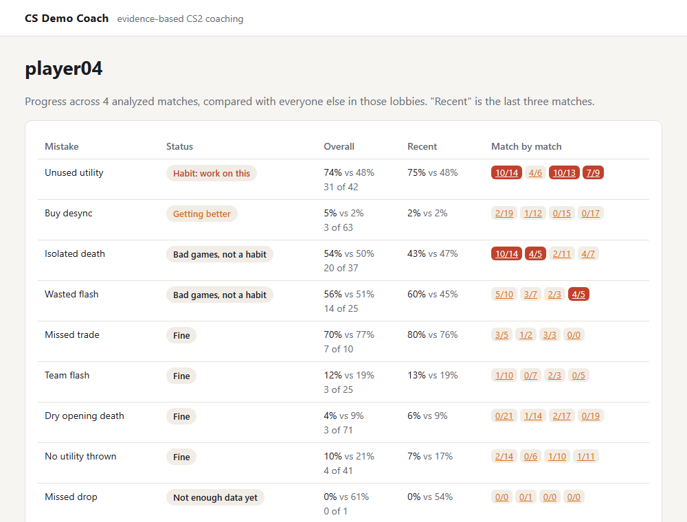

# v0.2 walkthrough

v0.1 coached one match. v0.2 makes the service usable by a real party: it runs
online, people sign in with Steam, their mistakes are tracked across matches,
and a brief arrives before the weekend games.

## What changed

1. **Calibration on real data** ([ADR 2](decisions/0002-first-detectors.md)).
   Nine 2026 matchmaking demos from the target users showed that the old
   economy check almost never fired: matchmaking parties buy in sync. The real
   mistakes were missing drops and under-buying with money. A new
   "no utility thrown" detector catches players who rarely buy grenades. It
   turned out to be the party's strongest shared habit.
2. **Remote worker over HTTPS** ([ADR 4](decisions/0004-postgres-queue-pull-workers.md)).
   The worker no longer needs database access. It talks only to the API with
   a token, so it runs on a home PC with the GPU and a ChatGPT login, while
   Postgres stays unexposed. The same `Queue` interface is backed by the
   store directly or by an HTTP client.
3. **Steam sign-in, invites, quotas** ([ADR 6](decisions/0006-steam-sign-in.md)).
   OpenID gives the same SteamID64 that demos use, so accounts link to matches
   with no setup. Access is invite-only. Sessions are hashed tokens, POSTs are
   checked against the site origin, and users see only matches they uploaded
   or played in. Weekly quotas bound LLM cost.
4. **Issue history** ([ADR 7](decisions/0007-issue-history.md)). Each mistake
   gets a status across a player's matches: habit, getting better, fixed,
   bad games, fine. The rules are the same statistical test as single-match
   coaching, applied to totals and to the last three matches.
5. **Weekly brief** ([ADR 8](decisions/0008-weekly-brief.md)). On Friday
   afternoon each user gets a brief for their usual party, which is detected
   automatically. It is built from everyone's history, validated like any
   advice, and coached on the home worker.
6. **Codex provider.** Coaching can run on a ChatGPT subscription through the
   official Codex CLI instead of an API key.

## Running it

- **Server:** `deploy/compose.prod.yaml` runs Postgres (not published) and the
  API on a loopback port behind the host's reverse proxy. Secrets live in a
  gitignored `deploy/.env`. The API image does not compile the demo parser,
  so it builds in about a minute on a 2-vCPU VPS. Together the two containers
  use about 60 MB of RAM.
- **Home worker:** `bin/worker.exe` with `.env.worker`, kept alive by
  `scripts/worker.ps1` (it can be registered to start at logon). A demo is
  parsed in about 2 s and coached with ChatGPT in about 30 s.

## Problems worth noting

- **The detector that never fired.** It was designed from intuition about
  split buys. Real data said matchmaking teams buy together. The check was
  rebuilt around what the data showed (missing drops, under-buys), and the
  ADR records the numbers.
- **A test caught a scheduling bug.** Duplicate weekly briefs were prevented
  by "created after the deadline", which fails when a brief is made manually
  or in tests with a different clock. Keying it on the period the brief covers
  fixed both cases.
- **An ungrounded but plausible LLM.** The model wrote "m13" (internal IDs)
  and "0:00" (round-level findings) into its prose. Examples now carry a
  human label ("de_dust2, Oct 24"), round-level findings have no time, and
  the prompt forbids IDs in text.
- **Security by construction:**
  - the worker has no database access;
  - session tokens are stored only as hashes;
  - match IDs of other users return 404;
  - redirects carry fixed codes, not text.

## Tests

On top of v0.1:
- the Steam OpenID verifier against a fake provider;
- the full sign-in and invite flow, invite reuse, logout, cross-site POST,
  visibility and quotas on a real database;
- history status rules;
- party detection, the schedule, and brief input that passes validation;
- the end-to-end brief: planner → remote worker → ready brief, through a real
  API server.

## Known limits

- History orders matches by upload time, not by when they were played.
- The brief is only shown on the website; there is no notification yet.
- Display names come from demos, so a new user shows as a SteamID until their
  first analyzed match.
