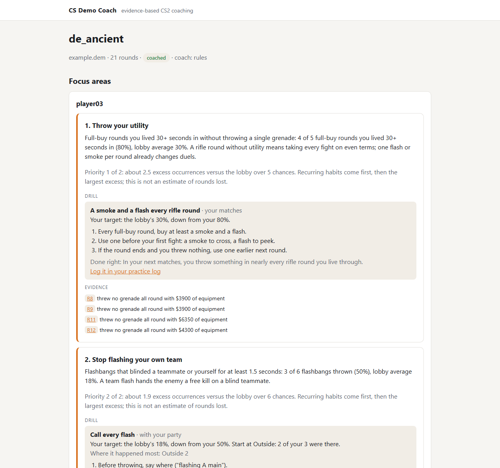

# v1.0 walkthrough

v1.0 completes the coaching loop for an invited party: import matches, choose
who to coach, get a short list of priorities with evidence, practice, and see
what changes in the next weekly brief. It builds on v0.1–v0.8 without adding a
database migration or another service.

## What changed

- **Explained priorities.** Focus cards on match and weekly pages, JSON and
  CLI reports explain their rank using excess occurrences against the lobby.
  Active habits come before improving ones; larger excess comes next. These
  are counts of mistakes above an expected lobby baseline, not rounds lost.
- **A concrete three-player plan.** Role advice can name who flashes, who
  goes first and who follows to trade. It is a plan to rehearse, backed by the
  entry's dry opening deaths, rather than an invented map execute.
- **A consistent weekly snapshot.** Matches and practice after the brief's
  cutoff do not affect its history, examples, roles or names. Changing a
  nickname no longer disconnects old evidence from the party member.
- **A stricter coaching contract.** Duplicate focus areas, too many team
  items, null replies, blank explanations and another player's primary
  evidence are rejected. Every worker coaching result is validated before
  saving. A permanent validation failure keeps match findings available.
- **Useful quiet weeks.** Resolved issues get a short acknowledgement.
  When nothing stands out, the coach says more matches may be needed and
  avoids an LLM call; concrete pair advice is still available. Weekly briefs
  no longer warn about “0 rounds”.

The design and compatibility rules are in [ADR 18](decisions/0018-release-coaching-contract.md).

The screenshot uses an anonymized committed match fixture, not a user's account.

## Requirements audit

`SCOPE.md` is the product contract; ADRs record the later decisions that
refined it. Local operational instructions are not part of the public product.

| Requirement | Implementation and checks |
|---|---|
| Import `.dem` files and Steam matches | Browser upload, `csdc watch`, per-user tokens, share-code polling and GC bot; deduplication and download/expiry tests |
| Choose which matches and players receive coaching | Imported demos produce deterministic findings; a user explicitly selects up to five players and requests individual match coaching. Weekly coaching follows the configured schedule or an explicit request |
| At most 1–3 ranked focus areas | Eligibility test against the lobby, a three-focus validation cap, shared final ranking and computed priority explanations |
| Evidence, frequency, location and a practice drill | Finding IDs, match/round/time links, counts and rates, place names and a validated curated drill library |
| Say when data is insufficient | Stand-out thresholds, history's minimum chances, short-match and quiet-history notes; no fabricated focus |
| Treat the party as a unit | Shared mistakes, directional trade pairs, roles, named flash support and a three-player practice plan |
| Track history and improvement | Active/improving/resolved/one-off statuses, recent rates, trend charts and a resolved-issue acknowledgement |
| Use practice notes and evaluate drills | Private practice log, computed before/after verdicts, alternate drills when practice is not working; no teammate note disclosure |
| A weekly brief before the usual games | Configurable Friday schedule/time zone, manual request, stored input snapshot and Telegram delivery |
| Invite-only accounts and per-user limits | Steam sign-in, invitations, hashed sessions/upload tokens, visibility checks and rolling upload/coaching quotas |
| Small LLM cost and replaceable providers | Compact aggregates/examples, request quotas, one correction attempt, no call when no focus is eligible; rules, Ollama, compatible API and CLI providers behind interfaces |
| Async work on a separate machine | Postgres job queue, HTTPS pull worker, retry/backoff and stale-job takeover |
| Delete demos after parsing | Worker deletes the demo after saving detection; parsed event data and findings remain for reports/backfills |
| Reproducible detection | Parser-independent model, sorted output, anonymized fixtures and golden reports; race and database integration tests |

The initial detector wish list was refined during calibration in
[ADR 2](decisions/0002-first-detectors.md); it is not a promise to implement
every example in the original problem statement. Rank benchmarks and
third-party enrichment remain explicitly listed as **Later** in SCOPE.

## What to try

1. Import a fresh demo or let the existing watcher/share-code import do it.
   Open the match, select the party and press **Coach us**.
2. Check that each focus has a priority explanation, a usable drill and
   evidence links that open the right rounds. Old saved advice keeps its old
   format until coaching is requested again.
3. Open **My progress**, inspect habits, role numbers and trade partners,
   then log a drill from its card. A practice verdict needs at least three
   matches after practice; it is a trend, not proof of causation.
4. Request a new weekly brief. Check personal priorities, the named team
   plan when its conditions are met, and the Telegram link to the evidence.

## Release limits

Distances ignore walls; role numbers mix T and CT; browser uploads use upload
time when the match date is unknown. LLM validation checks citations and
structure rather than every sentence. There are no rank-based benchmarks or
map-specific execute library. Those limits do not disappear with a version
number, and gameplay feedback should guide the next changes.

## Verification

- `go build ./...`, `go vet ./...` and `golangci-lint run`.
- `go test -race ./...` against local Postgres, including remote-worker and
  real-demo paths; `npm test` in `bot/` (12 tests).
- New regressions cover ranking, model priority overrides, validation, name
  changes, the exclusive weekly cutoff, input immutability and skipped LLM calls.
- Match, progress and weekly pages rendered from anonymized fixtures; match
  layout inspected in headless Chrome. Live Steam/Telegram delivery is an
  existing integration and was not triggered as part of this local release check.
